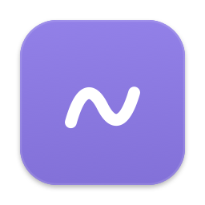
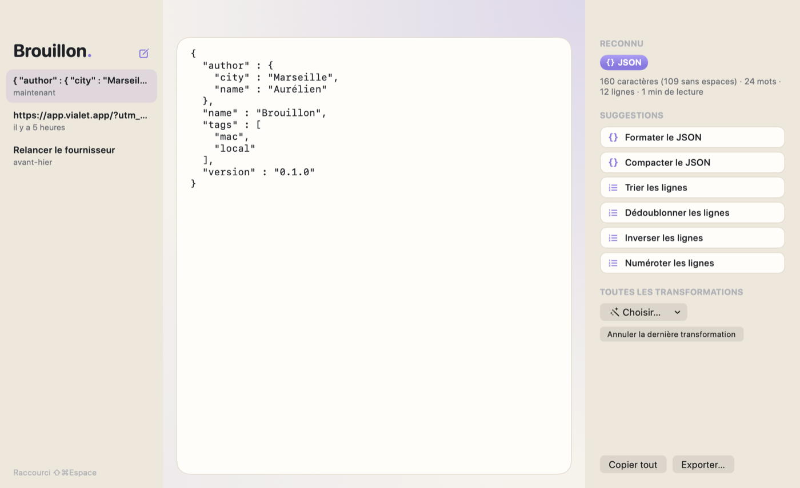

<div align="center">



# Brouillon

**Le bloc-notes qui comprend ce que vous y collez.**

[](https://github.com/avialet/brouillon/releases/latest)
[](#installation)
[](LICENSE)

[**Télécharger le DMG**](https://github.com/avialet/brouillon/releases/latest) · [Site](https://brouillon.vialet.app)



</div>

## Ce que fait Brouillon

Un bloc-notes pour tout ce qui passe par là : un JSON à lire, une URL à décoder, un texte à nettoyer, une liste à trier. Collez, Brouillon reconnaît ce que c'est et propose quoi en faire.

- **Il reconnaît ce que vous collez.** JSON, lien, couleur, code, chemin, nombre, timestamp, base64, entités HTML : une pastille le dit, et les suggestions suivent. Les compteurs (caractères, mots, lignes, temps de lecture) sont toujours là.
- **Une transformation, un clic, annulable.** Formater ou compacter un JSON, décoder une URL ou du base64, changer la casse, nettoyer les espaces et les caractères invisibles, trier, dédoublonner, numéroter ou inverser des lignes, convertir un timestamp en date ou une couleur en rgb(). Vingt-deux transformations, toutes pures, toutes réversibles.
- **Sauvegardé en continu, chez vous.** Chaque brouillon est enregistré au fil de la frappe dans un fichier SQLite sur votre Mac. Un raccourci global ramène la fenêtre avec le curseur dans le texte, depuis n'importe quelle app.
- **Verrouillé et chiffré.** Touch ID ou le mot de passe du Mac déverrouille Brouillon ; titres et textes sont chiffrés sur le disque (voir [Protection](#protection)).
- **Vos notes de l'app Notes, en un clic.** **Fichier › Importer depuis Notes…** reprend les dossiers choisis, en lecture seule, sans doublon si vous relancez.

## Installation

**Prérequis :** un Mac Apple Silicon sous macOS 26 (Tahoe) ou plus récent.

1. Téléchargez `Brouillon-X.Y.Z.dmg` depuis la [dernière version](https://github.com/avialet/brouillon/releases/latest).
2. Ouvrez le DMG et glissez **Brouillon** dans **Applications**, puis double-cliquez.
3. Au premier lancement, macOS indique qu'il n'a pas pu vérifier l'app (elle est signée
   sans certificat Apple Developer). Cliquez **Terminé** (pas « Placer dans la corbeille »),
   ouvrez **Réglages Système › Confidentialité et sécurité**, descendez jusqu'à
   « Brouillon a été bloqué… », cliquez **Ouvrir quand même**, authentifiez-vous, puis **Ouvrir**.
   Cette étape n'a lieu qu'une fois par téléchargement. Dans le Terminal :

   ```bash
   xattr -d com.apple.quarantine /Applications/Brouillon.app
   ```

Pour vérifier le fichier téléchargé, comparez son empreinte avec celle publiée dans la même version :

```bash
shasum -a 256 -c Brouillon-X.Y.Z.dmg.sha256
```

### Mises à jour

Brouillon consulte une fois par jour la dernière version publiée sur GitHub. S'il en
existe une plus récente, un clic la télécharge, **vérifie son empreinte SHA-256**, contrôle
l'application qu'elle contient, la remplace et relance l'app. Si une étape échoue, l'app
installée n'est pas touchée. La recherche automatique se désactive dans **Réglages › Mises à jour**.

Le seul échange réseau de Brouillon est cette lecture de la version publiée. Aucune donnée n'est envoyée.

## Notice

- **⌥⇧Espace** (modifiable dans les Réglages) ouvre Brouillon avec le curseur dans le texte, ou le masque.
- **⌘N** nouveau brouillon, **⇧⌘N** colle le presse-papiers dans un nouveau brouillon, **⌘E** exporte en `.txt` (ou `.json`), **⇧⌘C** copie tout.
- La colonne de droite affiche ce qui est reconnu, les compteurs et les **suggestions** ; le menu **Choisir…** et le menu **Transformer** donnent toutes les transformations, par famille. **⇧⌘Z** annule la dernière transformation (la frappe a son propre ⌘Z).
- La colonne de gauche liste les brouillons, du plus récent au plus ancien, avec un champ **Rechercher** (titres et textes, sans tenir compte des accents ni des majuscules). Clic droit pour supprimer.
- **⌃⌘L** verrouille Brouillon (menu **Brouillon › Verrouiller Brouillon**).
- L'icône de la barre des menus crée un brouillon, colle dans un nouveau brouillon, ou rouvre les derniers.
- Le lien `brouillon://new?text=…` crée un brouillon prérempli, pour un script ou un lanceur.
- Fermer la fenêtre ne quitte pas l'app : le raccourci et l'icône de la barre des menus restent actifs. **⌘Q** quitte vraiment.
- **Brouillon › À propos de Brouillon** affiche la version, la licence et les liens vers le site et le code source.

| Famille | Transformations |
|---|---|
| JSON | formater, compacter |
| Web | décoder / encoder une URL, décoder / encoder en base64, décoder les entités HTML |
| Casse | MAJUSCULES, minuscules, Majuscule À Chaque Mot, majuscule en début de phrase |
| Nettoyage | nettoyer les espaces, retirer les caractères invisibles, transformer en slug |
| Lignes | trier, dédoublonner, inverser, numéroter |
| Conversion | timestamp ↔ date ISO, couleur #hex ↔ rgb() |

### Importer depuis l'app Notes

**Fichier › Importer depuis Notes…** (ou l'icône de téléchargement en haut de la colonne) liste les
dossiers de l'app Notes avec leur nombre de notes. Cochez ceux à reprendre, puis **Importer**.

- La première fois, macOS demande si Brouillon peut contrôler Notes. Refusé par erreur ?
  **Réglages Système › Confidentialité et sécurité › Automatisation › Brouillon › Notes**.
- Lecture seule : Brouillon lit les notes (nom, texte, dates), il n'écrit jamais dans l'app Notes.
- Chaque note devient un brouillon qui garde ses dates. Listes, cases à cocher, liens et tableaux
  (en texte tabulé) sont convertis en texte ; une image devient `[image]`, une pièce jointe `[pièce jointe]`.
- Les notes verrouillées par un mot de passe dans Notes sont ignorées (et comptées dans le résumé),
  comme le dossier Suppressions récentes.
- Relancer l'import ne crée pas de doublon ; en revanche, une note dont vous avez supprimé le brouillon
  est importée de nouveau (décochez son dossier pour l'éviter).
- Une note sans nom ni texte est ignorée.
- Une note modifiée dans Notes depuis l'import est ignorée, sauf si vous cochez **Mettre à jour les
  notes modifiées** ; un brouillon que vous avez modifié dans Brouillon n'est alors jamais écrasé, la nouvelle version s'ajoute à côté.

### Protection

Activée d'office sur une nouvelle installation, proposée par une carte d'accueil aux bases existantes,
réglable dans **Réglages › Protection**.

- **Verrou.** Brouillon se verrouille au lancement, après 5 minutes sans activité dans l'app
  (1, 5, 15 ou 60 minutes), à la mise en veille et au verrouillage de l'écran, ou par **⌃⌘L**.
  Verrouillé, rien n'est affiché : ni texte, ni titre, ni brouillon dans le menu de la barre des menus.
  **Déverrouiller** demande Touch ID ou le mot de passe de votre session macOS.
- **Chiffrement.** Le titre et le texte de chaque brouillon sont chiffrés en AES-GCM 256 bits
  (CryptoKit) dans le fichier SQLite. La clé, aléatoire, est créée à l'activation et rangée dans votre
  trousseau de session (élément « Brouillon : clé de chiffrement des brouillons », service
  `fr.vialet.brouillon`, compte `notes-key`). Brouillon ne la lit qu'après Touch ID ou le mot de
  passe, la garde en mémoire tant que l'app est déverrouillée et l'efface au verrouillage.
- **Activation.** Avant de chiffrer une base existante, Brouillon en garde une copie en clair à côté,
  `brouillon.sqlite.avant-chiffrement` (jamais écrasée : `-2`, `-3`… ensuite), chiffre tout dans une
  seule transaction et relit chaque brouillon avant de valider : au moindre écart, rien n'est modifié.
  Supprimez cette copie quand tout va bien : elle contient vos brouillons en clair.
- **Désactivation.** Après Touch ID ou le mot de passe, les brouillons sont déchiffrés et réenregistrés
  en clair, avec la même relecture.

Ce que la protection couvre, et ce qu'elle ne couvre pas :

- Elle protège vos brouillons de quelqu'un qui s'assoit devant votre Mac resté ouvert, et le fichier
  de la base lu ailleurs (sauvegarde, copie, autre disque) : sans la clé, titres et textes sont illisibles.
- Ne sont pas chiffrés : les dates des brouillons, leur nombre, et la correspondance avec les notes
  importées (identifiants et dates de Notes, sans texte).
- Le trousseau utilisé est le trousseau de session classique : Brouillon est signée sans certificat
  Apple Developer et ne peut pas utiliser le trousseau protégé par l'app. Une app qui tourne sous votre
  session peut demander la clé ; macOS vous demande alors votre autorisation. Un logiciel malveillant
  déjà installé sous votre session peut aussi lire la mémoire de Brouillon déverrouillé.
- Touch ID ouvre la porte de l'app, il ne protège pas la clé lui-même : c'est le trousseau qui la garde.
- Après une mise à jour de Brouillon, macOS peut demander une fois l'accès à cet élément du trousseau
  (la signature change) : choisissez **Toujours autoriser**.
- **Pas de réinitialisation possible.** Si la clé disparaît du trousseau (trousseau réinitialisé,
  élément supprimé, base copiée sur un autre Mac sans son trousseau), les brouillons chiffrés sont
  illisibles, définitivement. Pour changer de Mac, désactivez la protection avant de copier la base,
  ou transférez aussi votre trousseau. Brouillon ne supprime jamais la clé, même en désactivant.
- Ce qui sort de Brouillon (presse-papiers, export, fichier `.txt`) n'est pas chiffré.

### Vos données

```text
~/Library/Application Support/Brouillon/brouillon.sqlite
```

Pour sauvegarder, copiez ce dossier (avec la protection, la copie est chiffrée : gardez la clé du
trousseau). Pour repartir de zéro, quittez l'app et supprimez-le.

## Compiler depuis les sources

Il faut Swift 6.3 ou plus récent (les Command Line Tools suffisent, Xcode n'est pas nécessaire).

```bash
git clone https://github.com/avialet/brouillon.git
cd brouillon
make test      # tests du noyau
make run       # construit et lance l'app
make install   # installe dans /Applications
make release   # fabrique build/Brouillon-X.Y.Z.dmg et son empreinte
```

| Dossier | Contenu |
|---|---|
| `Packages/BrouillonCore` | Noyau sans interface : transformations, statistiques, suggestions, brouillons SQLite ([GRDB](https://github.com/groue/GRDB.swift)), chiffrement, import depuis Notes, recherche |
| `Brouillon` | L'application SwiftUI ; `App/Brand.swift` porte son identité (nom, teintes, glyphe) |
| `scripts` | Assemblage de l'app et du DMG habillé (`scripts/dmg`) ; l'icône vient de la plaque (`make icon`) |
| `docs` | [Publier une version](docs/publier-une-version.md), [tests](docs/tests.md), notes de version |

Le socle commun (identité, police des titres, thème, Réglages, À propos, mises à jour, raccourci
global) vient de [VialetKit](https://github.com/avialet/vialetkit) 0.2. Publier une version ne demande que de
modifier `VERSION` puis de pousser un tag `vX.Y.Z` : la CI construit et publie le DMG, et
les utilisateurs reçoivent la mise à jour dans l'app.

## Confidentialité

Brouillon ne collecte rien. Vos données ne quittent jamais votre Mac. La seule requête
réseau est la lecture de la dernière version publiée sur GitHub, que vous pouvez désactiver.
L'app Notes n'est lue que lorsque vous lancez un import, par AppleScript (JavaScript for Automation), en lecture seule.

## Licence

[MIT](LICENSE) © 2026 Aurélien Vialet
